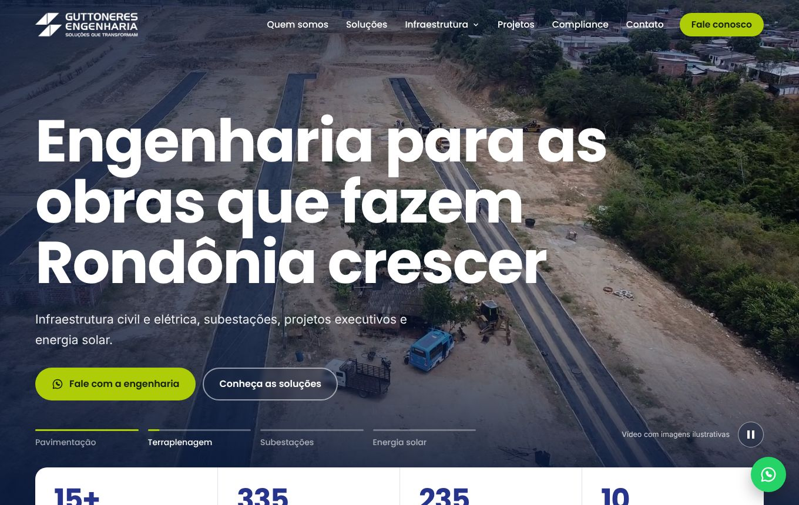
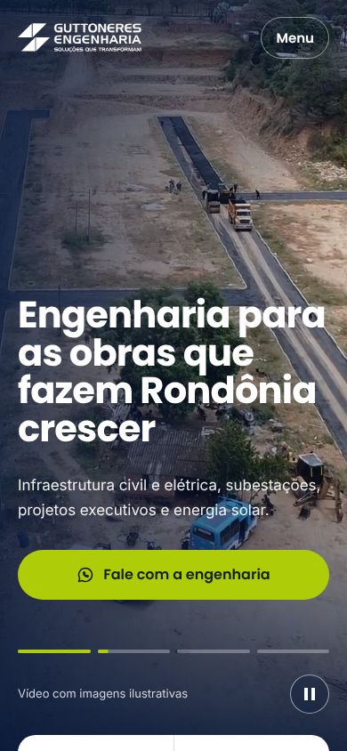

# Guttoneres Engenharia — site institucional

Nova versão do site da Guttoneres Engenharia, empresa de infraestrutura civil e elétrica de Porto Velho (RO). O site apresenta os serviços (terraplenagem, drenagem, pavimentação, rede de esgoto, subestações e energia solar), as obras, a equipe e a política de compliance, e leva o visitante para o WhatsApp comercial.

**[Abrir o site](https://kenzokishi.github.io/guttoneres-site/)** · publicado com autorização da empresa

## O que tem

- **Abertura em vídeo aéreo**, com botão de pausa e legenda das frentes de serviço.
- **Páginas de serviço** com vídeo de fundo que só carrega quando a seção aparece na tela (`data-src` + carregamento sob demanda), para o site não ficar pesado.
- **Números da empresa, obras e equipe**, seção de compliance e contato direto pelo WhatsApp.
- Página única, com HTML, CSS e JavaScript puros, sem framework. Imagens em WebP.
- Respeita `prefers-reduced-motion`: com movimento reduzido ligado, o vídeo não toca sozinho.

> Nesta cópia do GitHub, o vídeo de abertura original (11 MB) foi trocado por um clipe menor de pavimentação.
